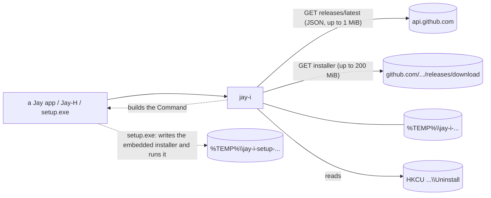

# Jay-I — Architecture

[Português](ARQUITETURA.md) · **English**

## 1. Purpose

Three apps of the Jay line carry copies of the same logic today: Jay-H's `products.rs` (installs and updates the other Jays, reads the registry, opens apps), Jay-E's `update.rs` and Jay-C's `update.rs` (self-update). The copies have already drifted apart (section 4): each gained a protection the others lack. Jay-I is the single version: a Rust crate without Tauri that finds the latest release on GitHub, picks the installer, downloads it, checks it, and builds the command that runs it. Windows only. License: MIT.

## 2. Design

1. **The `jay-i` crate (stage 1).** A plain library. No UI, no global state: functions take what they need (repository, User-Agent) and return `Result<_, String>`. The caller decides the UI, the "one install at a time" lock, and when to exit the process.
2. **The `setup.exe` (stage 2).** A program with the Jay UI (a fixed-size Tauri v2 window) that carries each app's Tauri NSIS installer inside and runs it silently. If WebView2 is missing, it falls back to the NSIS window (which knows how to install it). It has no install logic of its own: files, registry, shortcuts and the uninstaller stay NSIS's. It uses the crate only to read the registry (`installed`). Details in section 5.
3. **Adoption (stage 3).** Each Jay replaces its copy with the crate, in the order Jay-H, Jay-E, Jay-C, then the others. Each app's switch is a commit that deletes code.



## 3. API and the checks

```rust
pub const MAX_INSTALLER: u64 = 200 * 1024 * 1024;   // 200 MiB
pub const MAX_JSON: u64 = 1024 * 1024;              // 1 MiB
pub struct Release { pub tag_name, pub html_url, pub assets: Vec<ReleaseAsset> }  // GitHub's JSON
pub struct ReleaseAsset { name, size, browser_download_url, digest: Option<String> }
pub struct Installer { pub name, pub url, pub size: u64, pub sha256: String }      // after every check
pub fn latest(repo: &str, user_agent: &str) -> Result<Option<Release>, String>;    // 404 = None
pub fn pick_installer(repo: &str, release: &Release) -> Result<Installer, String>;  // pure
pub fn download(installer: &Installer, user_agent: &str, on_progress: impl FnMut(u64, u64)) -> Result<PathBuf, String>;
pub enum Mode { Interactive, Update { relaunch: bool } }
pub fn run(installer: &Path, mode: Mode) -> std::process::Command;  // not spawned; the caller spawns and exits, or waits
pub struct Installed { pub version: String, pub location: String }
pub fn installed(name: &str) -> Result<Option<Installed>, String>;  // HKCU Uninstall\{name}
pub fn newer(latest: &str, current: &str) -> bool;
```

- **`latest`.** `repo` must be `owner/name` (ASCII alphanumeric, `-`, `_`, `.`; no `..`); otherwise an error, before any network access. `GET https://api.github.com/repos/{repo}/releases/latest` through `ureq` 3, https only (a redirect to http is refused), timeouts of 10 s to resolve and connect and 30 s to send, receive the response and for each read, the caller's User-Agent, body capped at 1 MiB. 404 becomes `None`.
- **`pick_installer`.** Takes the first asset ending in `_x64-setup.exe`. The URL must start with `https://github.com/{repo}/releases/download/`; the name must not contain `/`, `\` or `:`; the size is at most 200 MiB; GitHub's `digest` must be `sha256:` plus 64 hex digits (uppercase passes). No `digest`, no installer.
- **`download`.** Creates `%TEMP%\jay-i-<pid>-<nanos>-<counter>` with `create_dir` (fails if present), reads the body with a limit of size+1, writes it to the file while computing the SHA-256, compares the length and the hash, and removes the whole directory on any failure. Not resumable (installers are 2 to 5 MB). On success the directory stays, so the caller can run from it.
- **`run`.** `Interactive`: no arguments (the NSIS window). `Update { relaunch }`: `/P /UPDATE`, plus `/R` if `relaunch`; `/P` shows only the progress bar, `/UPDATE` keeps settings, `/R` reopens the app. Arguments as a list, never through a shell.
- **`installed`.** Per user only: `HKCU\Software\Microsoft\Windows\CurrentVersion\Uninstall\{name}`, reads `DisplayVersion` and `InstallLocation` with the quotes trimmed. `name` must be ASCII alphanumeric or `-`. A missing key is `None`; a missing `DisplayVersion` is an error.
- **`newer`.** Strips `v`/`V`, ignores `-suffix` and `+build`, a missing part counts as 0, any non-numeric part means "not newer".

Dependencies: `ureq` 3 (json), `sha2` 0.10, `serde` 1 and `winreg` 0.56 (Windows only). These are what Jay-H already uses; nothing new. `serde_json` comes in through ureq's `json` feature (the crate doesn't call it directly).

## 4. What the three copies did differently

| # | Point | Jay-H | Jay-E | Jay-C | What Jay-I keeps |
|---|---|---|---|---|---|
| 1 | HTTP client | `ureq` | `ureq` | WinHTTP (no Rust TLS stack) | `ureq` (rustls). Jay-C loses its "no TLS stack" property when it adopts the crate: that is the trade-off |
| 2 | Cap on the release JSON | no | no | 1 MiB | 1 MiB |
| 3 | https only, redirects included | partial | partial | yes (WinHTTP secure flag; `split_url` rejects http, `user@host`, `:port`) | `https_only` in `ureq`; the download URL is pinned to `https://github.com/{repo}/releases/download/` by `pick_installer`, which already rules out userinfo and ports |
| 4 | Timeouts | no | no | 10/10/30/30 s | 10/10/30/30 s, plus one per read |
| 5 | 404 on `latest` | error | "no release" | "no release" | `None` |
| 6 | Download | to disk, size+1 limit | to disk, size+1 limit | all in memory, then written | to disk, streamed |
| 7 | Temp dir | created first, removed on failure | created first, removed on failure | created only after the check | as Jay-H/E, plus a counter in the name (two downloads in the same instant do not collide) |
| 8 | Version compare | JS `compareVersions` (suffix ignored; "1a" read as 1) | `semver` crate (unparseable tag = not newer; pre-release ordered) | same as Jay-H | the JS rule, stricter: any non-numeric part = not newer. No `semver` |
| 9 | Registry name and repo validation | only in a catalog test | same | same | inside the function: error before any registry or network access |
| 10 | One install at a time | `AtomicBool` | `Mutex` | `AtomicBool` | left to the caller (app level). The crate is safe to call twice (separate dirs) but does not stop two installers from running |
| 11 | User-Agent | hard-coded per app | hard-coded per app | hard-coded per app | a parameter |

## 5. The setup.exe (stage 2)

### Design

The repository is a cargo workspace: the `jay-i` crate at the root and the `jay-i-setup` package in `setup/`. The release profile (in the root `Cargo.toml`): `codegen-units = 1`, `lto`, `opt-level = "s"`, `panic = "abort"`, `strip`.

`setup/` builds **one** exe, `jay-i-setup.exe`, which the script renames to `<Name>_<version>_x64-setup.exe`. It is a Tauri v2 window of 480x560, not resizable or maximizable, with the Jay look. It carries (`include_bytes`) the NSIS installer that Tauri builds for the app and runs it silently. It installs nothing on its own.

- `setup/src/lib.rs`: the logic without Tauri (`parse`, `payload_args`, `webview2_installed`, `run_payload`, `open_app`, `install_folder`, `busy`).
- `setup/src/main.rs`: the window and 4 commands (`info`, `install`, `open`, `close`). A custom scheme, `jayi`, serves only `/mark.png`.
- `setup/src/bin/stub.rs`: a fake installer for the tests; never shipped.
- `setup/dist`: static `index.html`, `app.css` and `app.js`. No npm, no bundler.
- `setup/build.rs`, `setup/tauri.conf.json`, `setup/icons` (development icons, copied from Jay-S).
- `scripts/build-setup.ps1` builds the setup; `scripts/cdp.mjs` is the DevTools helper (adapted from Jay-S, port 9228).

### Build inputs

Everything is decided at build time; the setup reads no configuration at run time.

| Input | What it is |
|---|---|
| `JAYI_PAYLOAD` | path of the NSIS installer that goes inside |
| `JAYI_NAME` | the app's name; ASCII letters, digits and `-` only (the build fails otherwise) |
| `JAYI_VERSION` | the version |
| `JAYI_EXE` | the app's exe name (a plain name ending in `.exe`) |
| `JAYI_MARK` | the PNG shown in the window |
| `TAURI_CONFIG` | `{"productName","version","bundle":{"icon":[<.ico>]}}`; `tauri-build` 2.7.4 merges it into `tauri.conf.json` (`try_build` in tauri-build's `src/lib.rs`; tauri-codegen 2.7.4's `get_config` does the same for `generate_context!`). The first `.ico` becomes the exe's icon and version resource |

Without inputs (a plain `cargo build`, `test` or `clippy`), `build.rs` uses an empty payload and the name `Jay-Test`. Such a setup shows the Error screen ("this setup was built without an installer").

The script: `powershell -File scripts/build-setup.ps1 -Payload <nsis.exe> -Name Jay-S -Version 0.1.1 -Exe jay-s.exe -Icon <icon.ico> -Mark <mark.png> [-OutDir <folder>]`. It is ASCII-only and runs on Windows PowerShell 5.1. It runs `cargo build --release -p jay-i-setup --bin jay-i-setup`, copies the exe from cargo's target dir (read from `cargo metadata`) to `<OutDir>\<Name>_<Version>_x64-setup.exe`, prints the path and size, and clears the environment variables in a `finally` block. There is no Tauri bundle step: the exe is the artifact.

### Screens

One card, constant height (528 px in a 480x560 window; measured identical on all four screens).

| Screen | What it shows |
|---|---|
| Confirm | mark, name, "Version X", "Installed: Y" (only when installed), the install folder; primary button **Install** (or **Update**, when the app is already installed) and **Cancel** |
| Installing | indeterminate bar, "Installing Jay-S…", no buttons; the window refuses to close while it runs |
| Done | **Open <Name>** and **Close** |
| Error | "The installation didn't finish.", "Exit code: N" or, if the installer never ran, the error message from Rust (in English); **Try again** and **Close** |

- **Language** from the system: `navigator.languages` starting with `pt` gives pt-BR, anything else gives English (both complete). Light or dark follows the system.
- **Accessibility:** the status sits in an `aria-live` region; the error has `role="alert"`; focus goes to the primary button on each screen (on Installing, to the status line); everything is reachable by keyboard; with `prefers-reduced-motion` the bar is static and striped.
- **Page:** text only through `textContent`; `[hidden] { display: none !important }`. CSP: `default-src 'self'`, `script-src 'self'`, `style-src 'self'`, `img-src 'self' http://jayi.localhost jayi:`, `connect-src ipc: http://ipc.localhost`; no external address.
- **No capability file:** the page uses only the app's own 4 commands (Tauri 2 allows app commands without one) and no core plugin. The page never sends a path; it receives only the text of the install folder.
- **Folder shown:** where the app is installed, if it is (the template's `RestorePreviousInstallLocation` keeps it); otherwise `%LOCALAPPDATA%\<Name>`.
- **Open:** takes the folder from `jay_i::installed(name)` plus the exe name; the file must exist; it is started with that folder as its working directory, and the setup exits with 0.

### Flags

`parse` compares case-insensitively, by exact match (like NSIS's `GetOptions`). Anything else (`/D=`, `/ARGS`, junk) is ignored and never forwarded. A repeated flag counts once; the order is kept. "Template" is the `installer.nsi` that Tauri's bundler generated for Jay-S (975 lines) and its `utils.nsh`.

| Flag | The setup | The installer gets | Template |
|---|---|---|---|
| none | window, Confirm screen | `/S` | silent install; `.onInit` (504-517) reads `/P`, `/NS` and `/UPDATE`; the MUI2 language dialog is skipped when silent (`${unless} ${Silent}` around `LangDLL`, Modern UI 2 `Localization.nsh`) |
| `/P` | the window opens on Installing and closes itself on exit code 0; on failure it stays on Error | `/S` (the installer stays silent) | `/P` = passive: progress window only, closes by itself (755-758) |
| `/S` | no window at all | `/S` plus what was forwarded | NSIS built-in silent |
| `/UPDATE` | forwarded | `/UPDATE` | `UpdateMode=1` (514-517): skips the WebView2 install (598-599, "Skip if updating") and the start-menu and desktop shortcuts (938-941 and 967-970) |
| `/R` | forwarded | `/R` | relaunches the app at the end, only in silent or passive mode (`.onInstSuccess`, 761-772, `nsis_tauri_utils::RunAsUser`) |
| `/NS` | forwarded | `/NS` | no shortcuts (509-512; used at 938-941, 967-970) |

- In silent or passive mode the installer also creates the desktop shortcut (744-749), unless `/UPDATE` or `/NS` is given.
- **App running during the install:** the template's `CheckIfAppIsRunning` (`utils.nsh`, 24-64, called at `installer.nsi` 683; in the uninstaller, 800) finds the app through the Restart Manager. In silent (`utils.nsh` 42) or passive (43) mode it asks no question and force-closes it (`RmShutdown` with `RmForceShutdown`, 47). If closing fails, silent mode writes the message to an attached console and aborts (51-60).
- **Downgrades:** aborted in silent, passive and update modes only when `allowDowngrades` is false (551-579); Tauri's default allows them.
- **Callers:** Jay-E's updater runs the setup with `/P /UPDATE /R` (the setup shows Installing and closes; the installer gets `/S /UPDATE /R` and relaunches the app). Older Jay-H and Jay-C run it with no arguments, and Jay-H waits for the exit code.

### Without WebView2

The check comes before any window. It reads the `pv` value under `HKLM\SOFTWARE\WOW6432Node\Microsoft\EdgeUpdate\Clients\{F3017226-FE2A-4295-8BDF-00C3A9A7E4C5}`, then `HKLM\SOFTWARE\Microsoft\EdgeUpdate\Clients\{same}`, then `HKCU\Software\Microsoft\EdgeUpdate\Clients\{same}`. The runtime is present if the value is non-empty and not `0.0.0.0` (Microsoft's documented detection; the template's WebView2 section reads the same keys, `installer.nsi` 587-592).

Without WebView2 (and without `/S`), the installer runs with its own window: the forwarded flags, plus `/P` first if the setup got `/P`; never `/S`. The setup exits with its code. The NSIS installer can install WebView2 itself (its section, from line 584).

### Exit codes

- The setup's code is the installer's (0 = ok; NSIS uses 1 for a user cancel and 2 for a script abort).
- Cancel, or closing the window before installing: **1** (as NSIS reports a user cancel).
- The setup could not run the installer at all (temp folder, write, check, spawn): **2**.
- After the Error screen, Close: the installer's code.

### The temp file and the held handle

`run_payload` runs one at a time (`AtomicBool BUSY`). A second call returns "another install is already running". The button is disabled and a JS flag blocks double clicks; the `install` command also refuses early while busy, so the exit code is not overwritten.

1. Creates a fresh folder `%TEMP%\jay-i-setup-<pid>-<nanos>-<counter>` with `create_dir` (fails if it exists).
2. Writes the file with `share_mode(0)` (nobody else can open it while it is written) and closes it.
3. Reopens it read-only with `FILE_SHARE_READ`: others may read and run it; nobody may write, delete or rename it.
4. Reads it back **through that handle** and compares it byte by byte with the embedded payload. Whatever was checked stays locked until the installer exits; this closes the gap between the write and the lock.
5. Runs the installer with that folder as its working directory and waits.
6. Drops the handle and removes the folder on every path (up to 10 tries, 100 ms apart).

A held write handle does not work: the image loader opens the exe without `FILE_SHARE_WRITE`, so `CreateProcess` would fail. The installer runs from this fresh folder, not from Downloads.

The WebView2 profile lives in `%TEMP%\jay-i-setup-webview`, shared by all setups and **not deleted** (WebView2 keeps files locked until its processes exit). So nothing is left in `%LOCALAPPDATA%`.

### Dependencies

Only in the setup crate: `tauri` 2.12.5 (feature `custom-protocol`: a plain `cargo build` serves the embedded `dist` instead of a dev URL), `tauri-build` 2.7.4 (build), `winreg` 0.56 (already used by `jay-i`; the WebView2 check) and `jay-i` (path). The same versions as Jay-S. Nothing else; `serde` is not a direct dependency (`info` returns a tuple).

### Tests

- `parse`: each flag, lower and mixed case, unknown flags (`/D=C:\x`, `/ARGS`, `/X`, `"P"`, `""`, `"/P "`, `/UPDATES`) ignored, duplicates once, order kept.
- `payload_args` in every mode.
- `run_payload` with the `stub`: exit codes 0 and 7 pass through; the `stub` receives exactly the arguments given; the folder is gone after success and after failures (empty payload, names `""`, `..`, `a/b.exe`, `a\b.exe`, `c:x.exe`, a payload that is not an exe).
- While the `stub` runs: write, open for write, delete and rename of the file, and rename of its folder all fail; a second `run_payload` is refused.
- `held_payload_cannot_be_changed_before_it_runs`: right after `write_and_hold`, without running anything, write, append, delete and rename of the file and rename of its folder fail, and reading still works; after the handle drops, the file can be written.
- `webview2_is_installed_on_this_pc` asserts `true`: it only proves the registry read works on a PC with the runtime.

### Measurements

Result of 2026-11-10, Windows 11, Rust 1.99.1, WebView2 157.0.4341.46:

- `cargo test --workspace`: `jay-i` `11 passed; 0 failed; 1 ignored`; `jay_i_setup` (lib) `5 passed; 0 failed; 0 ignored`; `tests/run.rs` `3 passed; 0 failed; 0 ignored` (1.84 s). `cargo clippy --workspace --all-targets -- -D warnings`: no warnings.
- **Runs of the built setup, with the `stub` as the installer (never a real installer):**
  - Confirm, Install, Installing, Done, Close: exit 0; the `stub` got `/S`.
  - `stub` exiting 5: Error screen "Exit code: 5"; Close: the setup exits with 5.
  - `/update /ns /D=C:\x`: the `stub` got `/S /UPDATE /NS` (`/D` dropped).
  - `/S /R`: no window; exit 9 passed through; the `stub` got `/S /R`.
  - `/P /UPDATE /R`: closed by itself, exit 0, the `stub` got `/S /UPDATE /R`.
  - Closing the window (X) during Installing is refused; X on Confirm: exit 1.
  - The temp folder was gone after each run.
- **Screenshots** (through DevTools on port 9228, page only): Confirm, Installing and Done in pt-BR light and dark; Confirm light, Installing dark, Error light and dark in English; Installing with motion and with reduced motion (this PC has reduced motion on); Confirm with a 140-character folder path (wraps to 3 lines inside the card, no horizontal overflow, 87 px above the buttons). Card of 448x528 with 16 px margins on every screen; nothing clipped or overlapping. Window content: 480x560 CSS px; at 125% DPI the CSS size is the same, so the layout is the same (not shot at 125%).
- **Size:** setup with the `stub` (204,800 bytes): 3,427,328 bytes; with a 4,700,000-byte incompressible payload: 7,922,176 bytes (budget: 15 MB). So the setup adds about 3.2 MB to the installer.
- **Memory**, idle on Confirm, run **without** the debugging environment variable (so `--disable-gpu` applies, confirmed on the `msedgewebview2` browser command line), 7 processes (the setup and 6 `msedgewebview2`: browser, crashpad, gpu, network, storage, renderer): working set summed 299 MB in one run and 310 MB in another; private bytes summed 94 and 99 MB. The setup exe alone: 27 MB working set, 5 MB private. The summed working set counts shared pages once per process, so the real footprint lies between the two numbers.

### Known limits

- **Unsigned.** The exe is not code-signed: SmartScreen shows "Windows protected your PC" (unknown publisher) for a downloaded setup until it builds reputation. Same as today's NSIS installers. Signing is outside this stage.
- **Uninstalling** still shows the stock NSIS window (the uninstaller is NSIS's, untouched).
- **Browser keys.** The page blocks `contextmenu`, but the browser accelerator keys (F5, Ctrl+R, Ctrl+P, F12...) are **not** switched off: doing that natively, like Jay-S, needs `webview2-com`/`windows` as direct dependencies, which this stage did not add. F5 reloads the page: on Confirm it is harmless; during Installing a reload loses the screen, while the Rust side keeps running and the busy flag still blocks a second install.

## 6. Security

### Stage 1 — the crate

The line's 10-point checklist, applied to stage 1. For each: what was checked and what was not.

1. **Attack surface.** Two outbound https GETs (`api.github.com`, `github.com`), one registry read, one process launch (by the caller). No listener, no IPC of its own. *Checked:* that is all there is in the code. *Not checked:* what the NSIS installer does once launched; it is outside the crate.
2. **Access control / IDOR.** The caller passes `repo` and `name`; the crate validates them (section 3). But a caller that lets a page choose the `repo` could still point at any GitHub repository matching the rule. *Checked:* the validation and the pinned URL. *Not checked:* the callers; they must keep a fixed catalog of repositories and never pass page text through.
3. **Data permissions.** Files in `%TEMP%` with the user's default permissions; per-user registry (HKCU). No student data is touched. *Not checked:* custom ACLs on the temp dir (there are none).
4. **Untrusted input to a sensitive operation.** The release JSON goes through validation of URL, file name, size and hash before it becomes an `Installer`. The installer path only comes from our own temp dir. Arguments are a fixed list, no shell. The registry name is validated. *Checked:* the tests in point 10. *Not checked:* the installer's contents.
5. **Exposed credentials.** None. No token; the GitHub API is anonymous, with a limit of 60 requests per hour per IP. *Checked:* no secret in the code or the tests. *Effect:* behind a shared IP, `latest` can fail with 403; the caller shows the error.
6. **Authentication.** TLS to `api.github.com` and `github.com` (rustls, webpki roots). The installers are **not code-signed**. The SHA-256 comes from GitHub's own asset `digest`, i.e. the same trust root as the download itself: it protects against corruption, truncation and a swapped CDN object, **not** against a compromised GitHub account or repository. *Not checked:* who published the release.
7. **Resource abuse and races.** JSON capped at 1 MiB, installer at 200 MiB, body read up to size+1, timeouts on every step. TOCTOU between the check and the run: the file sits in a fresh per-call directory in `%TEMP%`, and another process of the same user could replace it before the caller runs it; but an attacker running as the same user has already won. The crate has no install lock (section 4, row 10).
8. **Dependency chain.** `ureq`, `rustls`, `sha2`, `serde`, `winreg`. `Cargo.lock` committed. `cargo audit`: not run. *Checked:* no new dependency compared with Jay-H.
9. **Network exposure.** Outbound only, `https_only`, no listening socket.
10. **Adversarial tests and release criteria.** Cases, all offline except the last:
    - lookalike host (`github.com.evil.example`) refused;
    - userinfo URL (`github.com@evil`) refused;
    - URL of another repository refused;
    - `http:` URL refused;
    - repo prefix trick (`Jay-C-evil` for the repo `Jay-C`) refused;
    - `digest` missing, short, long, non-hex or `md5:` refused; uppercase accepted;
    - size over the cap refused;
    - file name with `\` or `:` refused;
    - `repo` and `name` with `/..` or a backslash refused;
    - body longer than declared refused;
    - right length, wrong hash: neither the file nor the directory survives;
    - body shorter than declared refused;
    - one `#[ignore]` test downloads a real Jay-C installer and checks it (never runs it).

    Result (2026-11-10, Windows 11, Rust 1.99.1): `cargo test` → `11 passed; 0 failed; 1 ignored`; `cargo clippy --all-targets -- -D warnings` clean; `cargo test -- --ignored` → `1 passed`: it downloaded `Jay-C_0.5.2_x64-setup.exe` (v0.5.2, 2,436,827 bytes) and its SHA-256 `33b00918…68c21a3` matched GitHub's `digest`. An `http:` URL is refused by `https_only` before any connection (the test checks the message). *Not checked:* a real https→http redirect, and a server sending a longer or wrong body (no test server: those cases are proven on `store`, the part of the download that takes the body).

    **Blocks the release:** any of these failing, or `cargo clippy` warnings.

### Stage 2 — the setup.exe

The same 10 points, applied to the `setup.exe` (section 5). For each: what was checked and what was not.

1. **Attack surface.** A local window with 4 commands (`info`, `install`, `open`, `close`) and the `jayi` scheme, which serves only `/mark.png`. One process launched to install (the embedded installer) and one to open the app. Registry reads: the WebView2 keys and the app's uninstall key. The setup itself makes no network request and listens on no port. *Checked:* that is all there is in the code. *Not checked:* what the NSIS installer does; the `msedgewebview2` processes.
2. **Access control / IDOR.** The page sends no path and no argument: `install`, `open` and `close` take nothing from it. The app and exe names come from the build; the flags come from the command line, read by Rust. `open` uses the registry folder plus the exe name, which must be plain (no `/`, `\`, `:` or `..`), and the file must exist. *Checked:* the code and the name tests. *Not checked:* a fake install folder in the registry, planted by another process of the same user (whoever has the user has already won).
3. **Data permissions.** No student data. The temp folder and the WebView2 profile in `%TEMP%` have the user's default permissions. The installer file is locked (write, delete and rename refused) until the installer exits. *Not checked:* custom ACLs (there are none).
4. **Untrusted input to a sensitive operation.** The command line: only the 6 known flags pass, by exact match; `/D=`, `/ARGS` and junk are dropped (the `parse` tests). The build inputs `JAYI_NAME` and `JAYI_EXE` are validated by `build.rs`. The installer is written to a fresh folder, read back through the lock and compared byte by byte with the embedded one. Text enters the page only through `textContent`. *Not checked:* the contents of the embedded installer (whoever builds the setup is responsible for it).
5. **Exposed credentials.** None. No token, no network, no secret in the code or the tests. The build script uses no secret and clears the environment variables it sets.
6. **Authentication.** There is no login. The setup is **not code-signed**: SmartScreen warns "unknown publisher" until it builds reputation. Nothing in the setup proves who built it; all it guarantees is that it runs the installer embedded in it. *Not checked:* whether SmartScreen or an antivirus treats the setup differently from the NSIS installer.
7. **Resource abuse and races.**
    - **One install at a time:** `BUSY` in `run_payload`; disabled button and a JS flag; `install` refuses early.
    - **TOCTOU between write and run:** closed by the held handle (section 5, "The temp file and the held handle"); proven by the test `held_payload_cannot_be_changed_before_it_runs` and, with the installer running, by `running_payload_is_locked_and_a_second_run_is_refused`.
    - **Closing the window** during the install is refused.
    - **F5** reloads the page (known limit, section 5): the Rust side keeps running and the lock blocks a second install.
    - **DLL planting**, with the setup run from Downloads next to planted DLLs. Measured: the exe imports `dwmapi`, `comctl32` (side-by-side), `bcryptprimitives` and the KnownDLLs. `build.rs` links with `/DEPENDENTLOADFLAG:0x800` (`LOAD_LIBRARY_SEARCH_SYSTEM32` for static imports; `dumpbin /loadconfig` shows "0800 Dependent Load Flag"), and `main()` calls `SetDefaultDllDirectories(LOAD_LIBRARY_SEARCH_SYSTEM32)` first thing, through a 3-line `extern` declaration (no new dependency). Test: a 4 KB garbage file named `<x>.dll` placed next to a copy of the setup, for 42 names (`version`, `uxtheme`, `winmm`, `dwrite`, `profapi`, `cryptbase`, `propsys`, `dwmapi`, `bcryptprimitives`, `dxgi`, `d3d11`, `winhttp`, `wininet`, `urlmon`, etc.). *Before* `SetDefaultDllDirectories`, with `version.dll`, `cryptbase.dll` or `propsys.dll` planted, the setup stayed alive but never started WebView2 (the planted file was loaded by name at run time: a real DLL there would have run code). *With* it, all six names rechecked (none, `version`, `cryptbase`, `propsys`, `dwmapi`, `uxtheme`) start WebView2 normally. A planted `dwmapi.dll` was ignored even with the flag zeroed in a patched copy, so the static-import flag is in place (`dumpbin`) but its effect was not separately proven. *Not covered:* DLLs loaded before `main()` by the loader's own process init, names other than the 42 tried, and the `msedgewebview2` processes (they run from the WebView2 runtime folder, not from Downloads).
8. **Dependency chain.** In the setup crate: `tauri` 2.12.5, `tauri-build` 2.7.4, `winreg` 0.56 and `jay-i` (path), the same versions as Jay-S. Nothing else. `Cargo.lock` committed. `cargo audit`: **not run**.
9. **Network exposure.** No listener. The setup makes no request. The CSP does not let the page talk to an external address (`default-src 'self'`, `connect-src ipc: http://ipc.localhost`, images only from `'self'`, `http://jayi.localhost` and `jayi:`). *Not checked:* the traffic of the WebView2 processes (not measured).
10. **Adversarial tests and release criteria.** The tests in section 5's "Tests": unknown and mixed-case flags, invalid file names, an empty payload or one that is not an exe, write/delete/rename of the installer and its folder during the run and just before it, a second run refused, the temp folder removed on failures; plus the runs of the built setup and the planted-DLL test described above. Result: section 5, "Measurements".

    **Not verified:**
    - a real install, an update, a reinstall over a running app and the "Open" button: never run from here (a process started in this environment installs into a sandboxed AppData); the author runs them outside;
    - the "Update" / "Installed: Y" variant of the Confirm screen (no Jay app is registered as installed in this PC's visible registry);
    - a PC without WebView2 (the fallback path is unit-tested only through `payload_args`);
    - a screenshot at 125% DPI; screen reader behaviour (only the attributes were checked);
    - whether SmartScreen or an antivirus treats the setup differently from the NSIS installer;
    - `cargo audit`.

    **Blocks the release:** any test failing, `cargo clippy` warnings, the setup over 15 MB with its installer inside, or a real install by the author that fails.

## 7. Stages

| Stage | What | State |
|---|---|---|
| 1 | The `jay-i` crate | ✅ |
| 2 | `setup.exe` with the Jay UI, wrapping each app's NSIS installer, running it silently and falling back to the NSIS window without WebView2 | ✅ The author installed Jay-S 0.1.1 with the setup, outside the dev environment (2026-11-10): it installed correctly. Not recorded separately: updating over the running app, the Open button, a PC without WebView2 |
| 3 | Each Jay (Jay-H, Jay-E, Jay-C, then the others) replaces its own copy with the crate | to do |
