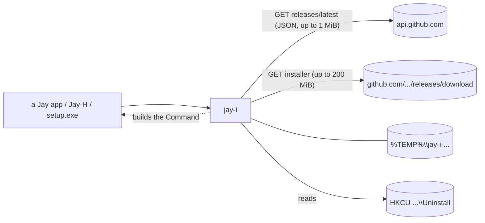

# Jay-I — Architecture

[Português](ARQUITETURA.md) · **English**

## 1. Purpose

Three apps of the Jay line carry copies of the same logic today: Jay-H's `products.rs` (installs and updates the other Jays, reads the registry, opens apps), Jay-E's `update.rs` and Jay-C's `update.rs` (self-update). The copies have already drifted apart (section 4): each gained a protection the others lack. Jay-I is the single version: a Rust crate without Tauri that finds the latest release on GitHub, picks the installer, downloads it, checks it, and builds the command that runs it. Windows only. License: MIT.

## 2. Design

1. **The `jay-i` crate (stage 1).** A plain library. No UI, no global state: functions take what they need (repository, User-Agent) and return `Result<_, String>`. The caller decides the UI, the "one install at a time" lock, and when to exit the process.
2. **The `setup.exe` (stage 2).** A program with the Jay UI that wraps each app's Tauri NSIS installer and runs it silently. If WebView2 is missing, it falls back to the NSIS window (which knows how to install it). It uses the crate and has no install logic of its own.
3. **Adoption (stage 3).** Each Jay replaces its copy with the crate, in the order Jay-H, Jay-E, Jay-C, then the others. Each app's switch is a commit that deletes code.



## 3. API and the checks

```rust
pub const MAX_INSTALLER: u64 = 200 * 1024 * 1024;   // 200 MiB
pub const MAX_JSON: u64 = 1024 * 1024;              // 1 MiB
pub struct Release { pub tag_name, pub html_url, pub assets: Vec<ReleaseAsset> }  // GitHub's JSON
pub struct ReleaseAsset { name, size, browser_download_url, digest: Option<String> }
pub struct Installer { pub name, pub url, pub size: u64, pub sha256: String }      // after every check
pub fn latest(repo: &str, user_agent: &str) -> Result<Option<Release>, String>;    // 404 = None
pub fn pick_installer(repo: &str, release: &Release) -> Result<Installer, String>;  // pure
pub fn download(installer: &Installer, user_agent: &str, on_progress: impl FnMut(u64, u64)) -> Result<PathBuf, String>;
pub enum Mode { Interactive, Update { relaunch: bool } }
pub fn run(installer: &Path, mode: Mode) -> std::process::Command;  // not spawned; the caller spawns and exits, or waits
pub struct Installed { pub version: String, pub location: String }
pub fn installed(name: &str) -> Result<Option<Installed>, String>;  // HKCU Uninstall\{name}
pub fn newer(latest: &str, current: &str) -> bool;
```

- **`latest`.** `repo` must be `owner/name` (ASCII alphanumeric, `-`, `_`, `.`; no `..`); otherwise an error, before any network access. `GET https://api.github.com/repos/{repo}/releases/latest` through `ureq` 3, https only (a redirect to http is refused), timeouts of 10 s to resolve and connect and 30 s to send, receive the response and for each read, the caller's User-Agent, body capped at 1 MiB. 404 becomes `None`.
- **`pick_installer`.** Takes the first asset ending in `_x64-setup.exe`. The URL must start with `https://github.com/{repo}/releases/download/`; the name must not contain `/`, `\` or `:`; the size is at most 200 MiB; GitHub's `digest` must be `sha256:` plus 64 hex digits (uppercase passes). No `digest`, no installer.
- **`download`.** Creates `%TEMP%\jay-i-<pid>-<nanos>-<counter>` with `create_dir` (fails if present), reads the body with a limit of size+1, writes it to the file while computing the SHA-256, compares the length and the hash, and removes the whole directory on any failure. Not resumable (installers are 2 to 5 MB). On success the directory stays, so the caller can run from it.
- **`run`.** `Interactive`: no arguments (the NSIS window). `Update { relaunch }`: `/P /UPDATE`, plus `/R` if `relaunch`; `/P` shows only the progress bar, `/UPDATE` keeps settings, `/R` reopens the app. Arguments as a list, never through a shell.
- **`installed`.** Per user only: `HKCU\Software\Microsoft\Windows\CurrentVersion\Uninstall\{name}`, reads `DisplayVersion` and `InstallLocation` with the quotes trimmed. `name` must be ASCII alphanumeric or `-`. A missing key is `None`; a missing `DisplayVersion` is an error.
- **`newer`.** Strips `v`/`V`, ignores `-suffix` and `+build`, a missing part counts as 0, any non-numeric part means "not newer".

Dependencies: `ureq` 3 (json), `sha2` 0.10, `serde` 1 and `winreg` 0.56 (Windows only). These are what Jay-H already uses; nothing new. `serde_json` comes in through ureq's `json` feature (the crate doesn't call it directly).

## 4. What the three copies did differently

| # | Point | Jay-H | Jay-E | Jay-C | What Jay-I keeps |
|---|---|---|---|---|---|
| 1 | HTTP client | `ureq` | `ureq` | WinHTTP (no Rust TLS stack) | `ureq` (rustls). Jay-C loses its "no TLS stack" property when it adopts the crate: that is the trade-off |
| 2 | Cap on the release JSON | no | no | 1 MiB | 1 MiB |
| 3 | https only, redirects included | partial | partial | yes (WinHTTP secure flag; `split_url` rejects http, `user@host`, `:port`) | `https_only` in `ureq`; the download URL is pinned to `https://github.com/{repo}/releases/download/` by `pick_installer`, which already rules out userinfo and ports |
| 4 | Timeouts | no | no | 10/10/30/30 s | 10/10/30/30 s, plus one per read |
| 5 | 404 on `latest` | error | "no release" | "no release" | `None` |
| 6 | Download | to disk, size+1 limit | to disk, size+1 limit | all in memory, then written | to disk, streamed |
| 7 | Temp dir | created first, removed on failure | created first, removed on failure | created only after the check | as Jay-H/E, plus a counter in the name (two downloads in the same instant do not collide) |
| 8 | Version compare | JS `compareVersions` (suffix ignored; "1a" read as 1) | `semver` crate (unparseable tag = not newer; pre-release ordered) | same as Jay-H | the JS rule, stricter: any non-numeric part = not newer. No `semver` |
| 9 | Registry name and repo validation | only in a catalog test | same | same | inside the function: error before any registry or network access |
| 10 | One install at a time | `AtomicBool` | `Mutex` | `AtomicBool` | left to the caller (app level). The crate is safe to call twice (separate dirs) but does not stop two installers from running |
| 11 | User-Agent | hard-coded per app | hard-coded per app | hard-coded per app | a parameter |

## 5. Security

The line's 10-point checklist, applied to stage 1. For each: what was checked and what was not.

1. **Attack surface.** Two outbound https GETs (`api.github.com`, `github.com`), one registry read, one process launch (by the caller). No listener, no IPC of its own. *Checked:* that is all there is in the code. *Not checked:* what the NSIS installer does once launched; it is outside the crate.
2. **Access control / IDOR.** The caller passes `repo` and `name`; the crate validates them (section 3). But a caller that lets a page choose the `repo` could still point at any GitHub repository matching the rule. *Checked:* the validation and the pinned URL. *Not checked:* the callers; they must keep a fixed catalog of repositories and never pass page text through.
3. **Data permissions.** Files in `%TEMP%` with the user's default permissions; per-user registry (HKCU). No student data is touched. *Not checked:* custom ACLs on the temp dir (there are none).
4. **Untrusted input to a sensitive operation.** The release JSON goes through validation of URL, file name, size and hash before it becomes an `Installer`. The installer path only comes from our own temp dir. Arguments are a fixed list, no shell. The registry name is validated. *Checked:* the tests in point 10. *Not checked:* the installer's contents.
5. **Exposed credentials.** None. No token; the GitHub API is anonymous, with a limit of 60 requests per hour per IP. *Checked:* no secret in the code or the tests. *Effect:* behind a shared IP, `latest` can fail with 403; the caller shows the error.
6. **Authentication.** TLS to `api.github.com` and `github.com` (rustls, webpki roots). The installers are **not code-signed**. The SHA-256 comes from GitHub's own asset `digest`, i.e. the same trust root as the download itself: it protects against corruption, truncation and a swapped CDN object, **not** against a compromised GitHub account or repository. *Not checked:* who published the release.
7. **Resource abuse and races.** JSON capped at 1 MiB, installer at 200 MiB, body read up to size+1, timeouts on every step. TOCTOU between the check and the run: the file sits in a fresh per-call directory in `%TEMP%`, and another process of the same user could replace it before the caller runs it; but an attacker running as the same user has already won. The crate has no install lock (section 4, row 10).
8. **Dependency chain.** `ureq`, `rustls`, `sha2`, `serde`, `winreg`. `Cargo.lock` committed. `cargo audit`: not run. *Checked:* no new dependency compared with Jay-H.
9. **Network exposure.** Outbound only, `https_only`, no listening socket.
10. **Adversarial tests and release criteria.** Cases, all offline except the last:
    - lookalike host (`github.com.evil.example`) refused;
    - userinfo URL (`github.com@evil`) refused;
    - URL of another repository refused;
    - `http:` URL refused;
    - repo prefix trick (`Jay-C-evil` for the repo `Jay-C`) refused;
    - `digest` missing, short, long, non-hex or `md5:` refused; uppercase accepted;
    - size over the cap refused;
    - file name with `\` or `:` refused;
    - `repo` and `name` with `/..` or a backslash refused;
    - body longer than declared refused;
    - right length, wrong hash: neither the file nor the directory survives;
    - body shorter than declared refused;
    - one `#[ignore]` test downloads a real Jay-C installer and checks it (never runs it).

    Result (2026-11-10, Windows 11, Rust 1.99.1): `cargo test` → `11 passed; 0 failed; 1 ignored`; `cargo clippy --all-targets -- -D warnings` clean; `cargo test -- --ignored` → `1 passed`: it downloaded `Jay-C_0.5.2_x64-setup.exe` (v0.5.2, 2,436,827 bytes) and its SHA-256 `33b00918…68c21a3` matched GitHub's `digest`. An `http:` URL is refused by `https_only` before any connection (the test checks the message). *Not checked:* a real https→http redirect, and a server sending a longer or wrong body (no test server: those cases are proven on `store`, the part of the download that takes the body).

    **Blocks the release:** any of these failing, or `cargo clippy` warnings.

## 6. Stages

| Stage | What | State |
|---|---|---|
| 1 | The `jay-i` crate | ✅ |
| 2 | `setup.exe` with the Jay UI, wrapping each app's NSIS installer, running it silently and falling back to the NSIS window without WebView2 | to do |
| 3 | Each Jay (Jay-H, Jay-E, Jay-C, then the others) replaces its own copy with the crate | to do |
