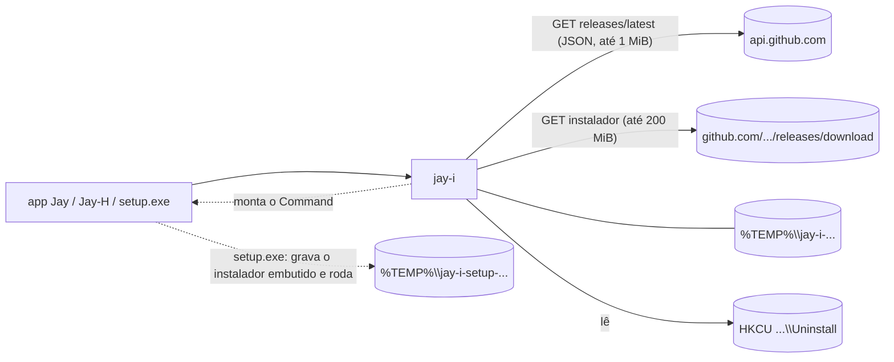

# Jay-I — Arquitetura

**Português** · [English](ARQUITETURA.en.md)

## 1. Objetivo

Hoje três apps da linha Jay levam cópias da mesma lógica: o `products.rs` do Jay-H (instala e atualiza os outros Jays, lê o registro, abre apps), o `update.rs` do Jay-E e o `update.rs` do Jay-C (autoatualização). As cópias já divergiram (seção 4): cada uma ganhou uma proteção que as outras não têm. O Jay-I é a versão única: uma crate Rust sem Tauri que acha a última release no GitHub, escolhe o instalador, baixa, confere e monta o comando que o roda. Só Windows. Licença: MIT.

## 2. Desenho

1. **A crate `jay-i` (etapa 1).** Biblioteca pura. Nada de interface, nada de estado global: as funções recebem o que precisam (repositório, User-Agent) e devolvem `Result<_, String>`. Quem chama decide a interface, o bloqueio de "uma instalação por vez" e quando sair do processo.
2. **O `setup.exe` (etapa 2).** Um programa com a interface Jay (uma janela Tauri v2 de tamanho fixo) que leva dentro o instalador NSIS do Tauri de cada app e o roda em silêncio. Se o WebView2 não existir, cai para a janela do NSIS (que sabe instalá-lo). Não tem lógica de instalação própria: arquivos, registro, atalhos e desinstalador continuam sendo do NSIS. Usa a crate só para ler o registro (`installed`). Detalhes na seção 5.
3. **Adoção (etapa 3).** Cada Jay troca a sua cópia pela crate, na ordem Jay-H, Jay-E, Jay-C, depois os outros. A troca de cada app é um commit que apaga código.



## 3. API e conferências

```rust
pub const MAX_INSTALLER: u64 = 200 * 1024 * 1024;   // 200 MiB
pub const MAX_JSON: u64 = 1024 * 1024;              // 1 MiB
pub struct Release { pub tag_name, pub html_url, pub assets: Vec<ReleaseAsset> }  // JSON do GitHub
pub struct ReleaseAsset { name, size, browser_download_url, digest: Option<String> }
pub struct Installer { pub name, pub url, pub size: u64, pub sha256: String }      // depois de todas as conferências
pub fn latest(repo: &str, user_agent: &str) -> Result<Option<Release>, String>;    // 404 = None
pub fn pick_installer(repo: &str, release: &Release) -> Result<Installer, String>;  // pura
pub fn download(installer: &Installer, user_agent: &str, on_progress: impl FnMut(u64, u64)) -> Result<PathBuf, String>;
pub enum Mode { Interactive, Update { relaunch: bool } }
pub fn run(installer: &Path, mode: Mode) -> std::process::Command;  // não roda; quem chama dá spawn e sai, ou espera
pub struct Installed { pub version: String, pub location: String }
pub fn installed(name: &str) -> Result<Option<Installed>, String>;  // HKCU Uninstall\{name}
pub fn newer(latest: &str, current: &str) -> bool;
```

- **`latest`.** `repo` precisa ser `dono/nome` (ASCII alfanumérico, `-`, `_`, `.`; sem `..`); senão erro, antes de qualquer rede. `GET https://api.github.com/repos/{repo}/releases/latest` com o `ureq` 3, só https (redirecionamento para http é recusado), tempos limite de 10 s para resolver e conectar e de 30 s para enviar, receber a resposta e cada leitura, User-Agent do chamador, corpo limitado a 1 MiB. 404 vira `None`.
- **`pick_installer`.** Pega o primeiro arquivo que termina em `_x64-setup.exe`. A URL precisa começar com `https://github.com/{repo}/releases/download/`; o nome não pode ter `/`, `\` nem `:`; o tamanho vai até 200 MiB; o `digest` do GitHub precisa ser `sha256:` mais 64 hexadecimais (maiúsculas passam). Sem `digest`, não há instalador.
- **`download`.** Cria `%TEMP%\jay-i-<pid>-<nanos>-<contador>` com `create_dir` (falha se já existir), lê o corpo com limite de tamanho+1, grava no arquivo enquanto calcula o SHA-256, compara o comprimento e o hash, e apaga a pasta inteira em qualquer falha. Não retoma (os instaladores têm de 2 a 5 MB). Em caso de sucesso a pasta fica, para o chamador rodar dali.
- **`run`.** `Interactive`: sem argumentos (janela do NSIS). `Update { relaunch }`: `/P /UPDATE`, mais `/R` se `relaunch`; `/P` mostra só a barra de progresso, `/UPDATE` mantém as configurações, `/R` reabre o app. Argumentos em lista, nunca por shell.
- **`installed`.** Só por usuário: `HKCU\Software\Microsoft\Windows\CurrentVersion\Uninstall\{name}`, lê `DisplayVersion` e `InstallLocation` sem as aspas. `name` precisa ser ASCII alfanumérico ou `-`. Chave ausente é `None`; `DisplayVersion` ausente é erro.
- **`newer`.** Tira `v`/`V`, ignora `-sufixo` e `+build`, parte faltando vale 0, qualquer parte não numérica significa "não é mais nova".

Dependências: `ureq` 3 (json), `sha2` 0.10, `serde` 1 e `winreg` 0.56 (só Windows). São as que o Jay-H já usa; nenhuma nova. O `serde_json` vem pelo recurso `json` do `ureq` (a crate não o chama direto).

## 4. O que as três cópias faziam de diferente

| # | Ponto | Jay-H | Jay-E | Jay-C | O que o Jay-I mantém |
|---|---|---|---|---|---|
| 1 | Cliente HTTP | `ureq` | `ureq` | WinHTTP (sem pilha TLS em Rust) | `ureq` (rustls). O Jay-C perde o "sem pilha TLS" ao adotar a crate: é o preço |
| 2 | Limite da resposta JSON | não | não | 1 MiB | 1 MiB |
| 3 | Só https, redirecionamentos incluídos | parcial | parcial | sim (flag do WinHTTP; `split_url` recusa http, `user@host`, `:porta`) | `https_only` do `ureq`; a URL do download é fixada em `https://github.com/{repo}/releases/download/` pelo `pick_installer`, o que já exclui usuário e porta |
| 4 | Tempos limite | não | não | 10/10/30/30 s | 10/10/30/30 s, mais um por leitura |
| 5 | 404 em `latest` | erro | "sem release" | "sem release" | `None` |
| 6 | Download | em disco, limite tamanho+1 | em disco, limite tamanho+1 | tudo na memória, depois grava | em disco, em fluxo |
| 7 | Pasta temporária | criada antes, apagada na falha | criada antes, apagada na falha | criada só depois da conferência | como Jay-H/E, com um contador no nome (dois downloads no mesmo instante não colidem) |
| 8 | Comparar versões | `compareVersions` do JS (sufixo ignorado; "1a" lido como 1) | crate `semver` (tag ilegível = não é mais nova; pré-release ordenada) | igual ao Jay-H | a regra do JS, mais estrita: parte não numérica = não é mais nova. Sem `semver` |
| 9 | Validar nome do registro e repositório | só num teste do catálogo | idem | idem | dentro da função: erro antes de tocar o registro ou a rede |
| 10 | Trava de uma instalação por vez | `AtomicBool` | `Mutex` | `AtomicBool` | do chamador (nível do app). A crate pode ser chamada duas vezes (pastas separadas), mas não impede dois instaladores ao mesmo tempo |
| 11 | User-Agent | fixo no app | fixo no app | fixo no app | parâmetro |

## 5. O setup.exe (etapa 2)

### Desenho

O repositório é um workspace do cargo: a crate `jay-i` na raiz e o pacote `jay-i-setup` em `setup/`. O perfil release (no `Cargo.toml` da raiz): `codegen-units = 1`, `lto`, `opt-level = "s"`, `panic = "abort"`, `strip`.

O `setup/` gera **um** exe, `jay-i-setup.exe`, que o script renomeia para `<Nome>_<versão>_x64-setup.exe`. É uma janela Tauri v2 de 480x560, sem redimensionar nem maximizar, com a cara Jay. Leva dentro (`include_bytes`) o instalador NSIS que o Tauri gera para o app e o roda em silêncio. Não instala nada por conta própria.

- `setup/src/lib.rs`: a lógica sem Tauri (`parse`, `payload_args`, `webview2_installed`, `run_payload`, `open_app`, `install_folder`, `busy`).
- `setup/src/main.rs`: a janela e 4 comandos (`info`, `install`, `open`, `close`). Um esquema próprio, `jayi`, serve só `/mark.png`.
- `setup/src/bin/stub.rs`: instalador falso para os testes; nunca vai no setup.
- `setup/dist`: `index.html`, `app.css` e `app.js` estáticos. Sem npm, sem bundler.
- `setup/build.rs`, `setup/tauri.conf.json`, `setup/icons` (ícones de desenvolvimento, copiados do Jay-S).
- `scripts/build-setup.ps1` gera o setup; `scripts/cdp.mjs` é o auxiliar de DevTools (adaptado do Jay-S, porta 9228).

### Entradas do build

Tudo é decidido na compilação; o setup não lê configuração em tempo de execução.

| Entrada | O que é |
|---|---|
| `JAYI_PAYLOAD` | caminho do instalador NSIS que vai dentro |
| `JAYI_NAME` | nome do app; só letras ASCII, dígitos e `-` (senão o build falha) |
| `JAYI_VERSION` | versão |
| `JAYI_EXE` | nome do exe do app (nome simples, termina em `.exe`) |
| `JAYI_MARK` | PNG mostrado na janela |
| `TAURI_CONFIG` | `{"productName","version","bundle":{"icon":[<.ico>]}}`; o `tauri-build` 2.7.4 junta isso ao `tauri.conf.json` (`try_build` em `src/lib.rs` do tauri-build; o `get_config` do tauri-codegen 2.7.4 faz o mesmo para o `generate_context!`). O primeiro `.ico` vira o ícone e o recurso de versão do exe |

Sem entradas (um `cargo build`, `test` ou `clippy` comum), o `build.rs` usa um payload vazio e o nome `Jay-Test`. Um setup assim mostra a tela de erro ("this setup was built without an installer").

O script: `powershell -File scripts/build-setup.ps1 -Payload <nsis.exe> -Name Jay-S -Version 0.1.1 -Exe jay-s.exe -Icon <icon.ico> -Mark <mark.png> [-OutDir <pasta>]`. É só ASCII e roda no Windows PowerShell 5.1. Roda `cargo build --release -p jay-i-setup --bin jay-i-setup`, copia o exe da pasta de destino do cargo (lida do `cargo metadata`) para `<OutDir>\<Nome>_<Versão>_x64-setup.exe`, mostra o caminho e o tamanho e limpa as variáveis de ambiente num `finally`. Não há etapa de bundle do Tauri: o exe é o artefato.

### Telas

Um cartão só, de altura constante (528 px numa janela 480x560; medido igual nas quatro telas).

| Tela | O que mostra |
|---|---|
| Confirmar | marca, nome, "Versão X", "Instalada: Y" (só se já instalada), a pasta de instalação; botão principal **Instalar** (ou **Atualizar**, se o app já está instalado) e **Cancelar** |
| Instalando | barra indeterminada, "Instalando o Jay-S…", sem botões; a janela se recusa a fechar enquanto roda |
| Pronto | **Abrir o <Nome>** e **Fechar** |
| Erro | "A instalação não terminou.", "Código de saída: N" ou, se o instalador nem chegou a rodar, a mensagem do Rust (em inglês); **Tentar de novo** e **Fechar** |

- **Idioma** pelo sistema: `navigator.languages` começando com `pt` vira pt-BR, o resto vira inglês (os dois completos). Claro ou escuro segue o sistema.
- **Acessibilidade:** o status fica numa região `aria-live`; o erro tem `role="alert"`; o foco vai para o botão principal em cada tela (em Instalando, para a linha de status); tudo alcançável pelo teclado; com `prefers-reduced-motion` a barra fica parada e listrada.
- **Página:** texto só por `textContent`; `[hidden] { display: none !important }`. CSP: `default-src 'self'`, `script-src 'self'`, `style-src 'self'`, `img-src 'self' http://jayi.localhost jayi:`, `connect-src ipc: http://ipc.localhost`; nenhum endereço externo.
- **Sem arquivo de capacidades:** a página só usa os 4 comandos do próprio app (o Tauri 2 libera comandos do app sem ele) e nenhum plugin do núcleo. A página nunca manda caminho; recebe só o texto da pasta de instalação.
- **Pasta mostrada:** a pasta onde o app está instalado, se estiver (o `RestorePreviousInstallLocation` do modelo a mantém); senão `%LOCALAPPDATA%\<Nome>`.
- **Abrir:** pega a pasta de `jay_i::installed(nome)` mais o nome do exe; o arquivo precisa existir; roda com essa pasta como diretório de trabalho e o setup sai com 0.

### Flags

O `parse` compara sem diferenciar maiúsculas, com igualdade exata (como o `GetOptions` do NSIS). Qualquer outra coisa (`/D=`, `/ARGS`, lixo) é ignorada e nunca repassada. Repetida vale uma vez; a ordem é mantida. "Modelo" é o `installer.nsi` que o bundler do Tauri gerou para o Jay-S (975 linhas) e o `utils.nsh`.

| Flag | O setup | O instalador recebe | Modelo |
|---|---|---|---|
| nenhuma | janela, tela Confirmar | `/S` | instalação silenciosa; o `.onInit` (504-517) lê `/P`, `/NS` e `/UPDATE`; o diálogo de idioma do MUI2 é pulado em modo silencioso (`${unless} ${Silent}` em volta do `LangDLL`, `Localization.nsh` do Modern UI 2) |
| `/P` | a janela já abre em Instalando e se fecha sozinha com código 0; se falhar, fica na tela Erro | `/S` (o instalador continua em silêncio) | `/P` = passivo: só a janela de progresso, fecha sozinho (755-758) |
| `/S` | sem janela nenhuma | `/S` mais o que foi repassado | silencioso nativo do NSIS |
| `/UPDATE` | repassada | `/UPDATE` | `UpdateMode=1` (514-517): pula a instalação do WebView2 (598-599, "Skip if updating") e os atalhos do menu Iniciar e da área de trabalho (938-941 e 967-970) |
| `/R` | repassada | `/R` | reabre o app no fim, só em modo silencioso ou passivo (`.onInstSuccess`, 761-772, `nsis_tauri_utils::RunAsUser`) |
| `/NS` | repassada | `/NS` | sem atalhos (509-512; usada em 938-941 e 967-970) |

- Em modo silencioso ou passivo o instalador também cria o atalho da área de trabalho (744-749), a menos que haja `/UPDATE` ou `/NS`.
- **App aberto durante a instalação:** o `CheckIfAppIsRunning` do modelo (`utils.nsh`, 24-64, chamado em `installer.nsi` 683; no desinstalador, 800) acha o app pelo Restart Manager. Em modo silencioso (`utils.nsh` 42) ou passivo (43) ele não pergunta e força o fechamento (`RmShutdown` com `RmForceShutdown`, 47). Se não conseguir fechar, o modo silencioso escreve a mensagem num console ligado e aborta (51-60).
- **Rebaixar versão:** abortado nos modos silencioso, passivo e de atualização só se `allowDowngrades` for falso (551-579); o padrão do Tauri permite.
- **Quem chama:** o atualizador do Jay-E roda o setup com `/P /UPDATE /R` (o setup mostra Instalando e se fecha; o instalador recebe `/S /UPDATE /R` e reabre o app). Jay-H e Jay-C mais antigos rodam sem argumentos, e o Jay-H espera o código de saída.

### Sem WebView2

A checagem vem antes de qualquer janela e lê o valor `pv` em `HKLM\SOFTWARE\WOW6432Node\Microsoft\EdgeUpdate\Clients\{F3017226-FE2A-4295-8BDF-00C3A9A7E4C5}`, depois em `HKLM\SOFTWARE\Microsoft\EdgeUpdate\Clients\{mesmo}`, depois em `HKCU\Software\Microsoft\EdgeUpdate\Clients\{mesmo}`. Existe se não for vazio nem `0.0.0.0` (a detecção documentada pela Microsoft; a seção do WebView2 do modelo lê as mesmas chaves, `installer.nsi` 587-592).

Sem WebView2 (e sem `/S`), o instalador roda com a janela dele: as flags repassadas, mais `/P` na frente se o setup recebeu `/P`; nunca `/S`. O setup sai com o código dele. O instalador NSIS sabe instalar o WebView2 (a seção dele, a partir da linha 584).

### Códigos de saída

- O código do setup é o do instalador (0 = ok; o NSIS usa 1 para cancelamento do usuário e 2 para script abortado).
- Cancelar, ou fechar a janela antes de instalar: **1** (como o NSIS informa um cancelamento).
- O setup não conseguiu rodar o instalador (pasta temporária, gravação, conferência, execução): **2**.
- Depois da tela Erro, Fechar: o código do instalador.

### O arquivo temporário e a trava

O `run_payload` roda um por vez (`AtomicBool BUSY`). Uma segunda chamada devolve "another install is already running". O botão fica desabilitado e uma marca no JS barra o clique duplo; o comando `install` também recusa cedo enquanto ocupado, para não sobrescrever o código de saída.

1. Cria uma pasta nova `%TEMP%\jay-i-setup-<pid>-<nanos>-<contador>` com `create_dir` (falha se existir).
2. Grava o arquivo com `share_mode(0)` (ninguém mais abre enquanto grava) e fecha.
3. Reabre só para leitura com `FILE_SHARE_READ`: outros podem ler e executar, ninguém pode escrever, apagar nem renomear.
4. Lê de volta **por esse handle** e compara byte a byte com o payload embutido. O que foi conferido é o que fica travado até o instalador terminar; isso fecha a brecha entre a gravação e a trava.
5. Roda o instalador com essa pasta como diretório de trabalho e espera.
6. Solta o handle e apaga a pasta, em qualquer caminho (até 10 tentativas, 100 ms entre elas).

Um handle de escrita mantido não serve: o carregador de imagens abre o exe sem `FILE_SHARE_WRITE`, e o `CreateProcess` falharia. O instalador roda dessa pasta nova, não de Downloads.

O perfil do WebView2 fica em `%TEMP%\jay-i-setup-webview`, igual para todos os setups e **não apagado** (o WebView2 mantém arquivos travados até os processos dele saírem). Assim não sobra nada em `%LOCALAPPDATA%`.

### Dependências

Só na crate do setup: `tauri` 2.12.5 (recurso `custom-protocol`: um `cargo build` comum serve o `dist` embutido, não uma URL de desenvolvimento), `tauri-build` 2.7.4 (build), `winreg` 0.56 (já usada pelo `jay-i`; checagem do WebView2) e `jay-i` (por caminho). São as mesmas versões do Jay-S. Mais nada; o `serde` não é dependência direta (`info` devolve uma tupla).

### Testes

- `parse`: cada flag, minúscula e mista, flags desconhecidas (`/D=C:\x`, `/ARGS`, `/X`, `"P"`, `""`, `"/P "`, `/UPDATES`) ignoradas, repetidas valem uma vez, ordem mantida.
- `payload_args` em todos os modos.
- `run_payload` com o `stub`: os códigos 0 e 7 passam; o `stub` recebe exatamente os argumentos dados; a pasta some depois do sucesso e das falhas (payload vazio, nomes `""`, `..`, `a/b.exe`, `a\b.exe`, `c:x.exe`, payload que não é exe).
- Com o `stub` rodando: gravar, abrir para escrita, apagar e renomear o arquivo, e renomear a pasta, tudo falha; uma segunda `run_payload` é recusada.
- `held_payload_cannot_be_changed_before_it_runs`: logo depois do `write_and_hold`, sem rodar nada, gravar, acrescentar, apagar e renomear o arquivo e renomear a pasta falham, e ler continua valendo; depois que o handle cai, o arquivo pode ser gravado.
- `webview2_is_installed_on_this_pc` espera `true`: só prova que a leitura do registro funciona num PC com o runtime.

### Medidas

Resultado de 10/11/2026, Windows 11, Rust 1.99.1, WebView2 157.0.4341.46:

- `cargo test --workspace`: `jay-i` `11 passed; 0 failed; 1 ignored`; `jay_i_setup` (lib) `5 passed; 0 failed; 0 ignored`; `tests/run.rs` `3 passed; 0 failed; 0 ignored` (1,84 s). `cargo clippy --workspace --all-targets -- -D warnings`: sem avisos.
- **Execuções do setup construído, com o `stub` como instalador (nunca um instalador de verdade):**
  - Confirmar, Instalar, Instalando, Pronto, Fechar: saída 0; o `stub` recebeu `/S`.
  - `stub` com saída 5: tela Erro "Código de saída: 5"; Fechar: o setup sai com 5.
  - `/update /ns /D=C:\x`: o `stub` recebeu `/S /UPDATE /NS` (o `/D` caiu).
  - `/S /R`: sem janela; a saída 9 passou; o `stub` recebeu `/S /R`.
  - `/P /UPDATE /R`: fechou sozinho, saída 0, o `stub` recebeu `/S /UPDATE /R`.
  - Fechar a janela (X) em Instalando é recusado; X em Confirmar: saída 1.
  - A pasta temporária sumiu depois de cada execução.
- **Capturas** (pelo DevTools na porta 9228, só a página): Confirmar, Instalando e Pronto em pt-BR claro e escuro; Confirmar claro, Instalando escuro, Erro claro e escuro em inglês; Instalando com movimento e com movimento reduzido (este PC tem movimento reduzido ligado); Confirmar com um caminho de 140 caracteres (quebra em 3 linhas dentro do cartão, sem rolagem horizontal, 87 px acima dos botões). Cartão de 448x528 com 16 px de margem em todas as telas; nada cortado nem sobreposto. Conteúdo da janela: 480x560 px CSS; a 125% de DPI o tamanho CSS é o mesmo, então o layout é o mesmo (não fotografado a 125%).
- **Tamanho:** setup com o `stub` (204 800 bytes): 3 427 328 bytes; com um payload incompressível de 4 700 000 bytes: 7 922 176 bytes (orçamento: 15 MB). O setup soma cerca de 3,2 MB ao instalador.
- **Memória**, parado em Confirmar, rodando **sem** a variável de depuração (para valer o `--disable-gpu`, confirmado na linha de comando do `msedgewebview2`), 7 processos (o setup e 6 `msedgewebview2`: browser, crashpad, gpu, network, storage, renderer): *working set* somado 299 MB numa rodada e 310 MB em outra; bytes privados somados 94 e 99 MB. O exe do setup sozinho: 27 MB de *working set*, 5 MB privados. A soma do *working set* conta páginas compartilhadas uma vez por processo, então o uso real fica entre os dois números.

### Limites conhecidos

- **Sem assinatura.** O exe não é assinado: o SmartScreen mostra "O Windows protegeu o computador" (editor desconhecido) para um setup baixado, até ele ganhar reputação. Igual aos instaladores NSIS de hoje. Assinar fica fora desta etapa.
- **Desinstalar** continua mostrando a janela comum do NSIS (o desinstalador é do NSIS, intocado).
- **Teclas do navegador.** A página bloqueia o `contextmenu`, mas as teclas de atalho do navegador (F5, Ctrl+R, Ctrl+P, F12...) **não** foram desligadas: fazer isso por dentro, como o Jay-S, pede `webview2-com`/`windows` como dependências diretas, e esta etapa não as somou. O F5 recarrega a página: em Confirmar é inofensivo; durante Instalando um recarregamento perde a tela, enquanto o lado Rust segue e a trava ainda barra uma segunda instalação.

## 6. Segurança

### Etapa 1 — a crate

Os 10 pontos do checklist da linha, sobre a etapa 1. Para cada um: o que foi conferido e o que não foi.

1. **Superfície de ataque.** Dois GET https de saída (`api.github.com`, `github.com`), uma leitura do registro, um processo lançado (por quem chama). Sem listener, sem IPC próprio. *Conferido:* é só isso no código. *Não conferido:* o que o instalador NSIS faz depois de lançado; está fora da crate.
2. **Controle de acesso / IDOR.** O chamador passa `repo` e `name`; a crate os valida (seção 3). Mas um chamador que deixe uma página escolher o `repo` ainda poderia apontar para qualquer repositório do GitHub que case com a regra. *Conferido:* a validação e a URL fixada. *Não conferido:* os chamadores; eles precisam ter um catálogo fixo de repositórios e nunca repassar texto da página.
3. **Permissões de dados.** Arquivos em `%TEMP%` com as permissões padrão do usuário; registro por usuário (HKCU). Nenhum dado do estudante é tocado. *Não conferido:* ACLs próprias na pasta temporária (não há).
4. **Entrada não confiável até operação sensível.** O JSON da release passa por validação de URL, nome do arquivo, tamanho e hash antes de virar `Installer`. O caminho do instalador só vem da nossa pasta temporária. Os argumentos são uma lista fixa, sem shell. O nome no registro é validado. *Conferido:* testes do ponto 10. *Não conferido:* o conteúdo do instalador.
5. **Credenciais expostas.** Nenhuma. Sem token; a API do GitHub é anônima, com limite de 60 requisições por hora por IP. *Conferido:* nada de segredo no código nem nos testes. *Efeito:* atrás de um IP compartilhado, `latest` pode falhar com 403; o chamador mostra o erro.
6. **Autenticação.** TLS para `api.github.com` e `github.com` (rustls, raízes do webpki). Os instaladores **não são assinados** (code signing). O SHA-256 vem do `digest` do próprio GitHub, ou seja, da mesma raiz de confiança do download: protege contra corrupção, truncamento e um objeto trocado na CDN, **não** contra uma conta ou um repositório do GitHub comprometido. *Não conferido:* a identidade de quem publicou a release.
7. **Abuso de recursos e corridas.** JSON limitado a 1 MiB, instalador a 200 MiB, corpo lido até tamanho+1, tempos limite em toda etapa. TOCTOU entre a conferência e a execução: o arquivo fica numa pasta nova por chamada em `%TEMP%`, e outro processo do mesmo usuário poderia trocá-lo antes de o chamador rodar; mas um atacante com o mesmo usuário já ganhou. A crate não tem trava de instalação (seção 4, linha 10).
8. **Cadeia de dependências.** `ureq`, `rustls`, `sha2`, `serde`, `winreg`. `Cargo.lock` no git. `cargo audit` 0.23.0 (2026-11-10): 0 vulnerabilidades em 446 crates; 2 avisos que não reprovam, em crates que só entram no build de Linux do Tauri (`glib` 0.18.5 *unsound*, `proc-macro-error` sem manutenção). Roda na CI a cada push e toda segunda-feira. *Conferido:* nenhuma dependência nova em relação ao Jay-H.
9. **Rede e exposição.** Só saída, `https_only`, nenhum socket em escuta.
10. **Testes adversariais e critérios de release.** Casos, todos sem rede, exceto o último:
    - URL com host parecido (`github.com.evil.example`) recusada;
    - URL com usuário (`github.com@evil`) recusada;
    - URL de outro repositório recusada;
    - URL `http:` recusada;
    - truque de prefixo (`Jay-C-evil` para o repositório `Jay-C`) recusado;
    - `digest` ausente, curto, longo, não hexadecimal ou `md5:` recusado; maiúsculas aceitas;
    - tamanho acima do limite recusado;
    - nome do arquivo com `\` ou `:` recusado;
    - `repo` e `name` com `/..` ou barra invertida recusados;
    - corpo maior que o declarado recusado;
    - tamanho certo e hash errado: nem o arquivo nem a pasta sobrevivem;
    - corpo menor que o declarado recusado;
    - um teste `#[ignore]` baixa um instalador real do Jay-C e o confere (nunca roda).

    Resultado (10/11/2026, Windows 11, Rust 1.99.1): `cargo test` → `11 passed; 0 failed; 1 ignored`; `cargo clippy --all-targets -- -D warnings` sem avisos; `cargo test -- --ignored` → `1 passed`: baixou o `Jay-C_0.5.2_x64-setup.exe` (v0.5.2, 2 436 827 bytes) e o SHA-256 `33b00918…68c21a3` bateu com o `digest` do GitHub. A URL `http:` é recusada pelo `https_only` antes de qualquer conexão (o teste confere a mensagem). *Não conferido:* um redirecionamento https→http de verdade e um servidor que mande corpo maior ou errado (sem servidor de teste: esses casos são provados no `store`, a parte do download que recebe o corpo).

    **Bloqueia a release:** qualquer um desses falhando, ou `cargo clippy` com avisos.

### Etapa 2 — o setup.exe

Os mesmos 10 pontos, sobre o `setup.exe` (seção 5). Para cada um: o que foi conferido e o que não foi.

1. **Superfície de ataque.** Uma janela local com 4 comandos (`info`, `install`, `open`, `close`) e o esquema `jayi`, que serve só `/mark.png`. Um processo lançado para instalar (o instalador embutido) e um para abrir o app. Leituras do registro: as chaves do WebView2 e a chave de desinstalação do app. O setup em si não faz nenhuma requisição de rede e não escuta em porta nenhuma. *Conferido:* é só isso no código. *Não conferido:* o que o instalador NSIS faz; os processos `msedgewebview2`.
2. **Controle de acesso / IDOR.** A página não manda caminho nem argumento: `install`, `open` e `close` não recebem nada dela. Nome do app e do exe vêm da compilação; as flags vêm da linha de comando, lida pelo Rust. O `open` usa a pasta do registro mais o nome do exe, que precisa ser simples (sem `/`, `\`, `:`, nem `..`), e o arquivo precisa existir. *Conferido:* o código e os testes de nome. *Não conferido:* uma pasta de instalação falsa no registro, posta por outro processo do mesmo usuário (quem já tem o usuário já ganhou).
3. **Permissões de dados.** Nenhum dado do estudante. A pasta temporária e o perfil do WebView2 em `%TEMP%` têm as permissões padrão do usuário. O arquivo do instalador fica travado (escrita, exclusão e renomeação recusadas) até o instalador terminar. *Não conferido:* ACLs próprias (não há).
4. **Entrada não confiável até operação sensível.** A linha de comando: só as 6 flags conhecidas passam, por igualdade exata; `/D=`, `/ARGS` e lixo são descartados (testes do `parse`). As entradas do build `JAYI_NAME` e `JAYI_EXE` são validadas pelo `build.rs`. O instalador é gravado numa pasta nova, lido de volta pela trava e comparado byte a byte com o embutido. O texto na página só entra por `textContent`. *Não conferido:* o conteúdo do instalador embutido (quem gera o setup é responsável por ele).
5. **Credenciais expostas.** Nenhuma. Sem token, sem rede, nenhum segredo no código nem nos testes. O script de build não usa segredo e limpa as variáveis de ambiente que cria.
6. **Autenticação.** Não há login. O setup **não é assinado**: o SmartScreen avisa "editor desconhecido" até ganhar reputação. Nada no setup prova quem o gerou; o que ele garante é só que roda o instalador que está embutido nele. *Não conferido:* se o SmartScreen ou um antivírus trata o setup diferente do instalador NSIS.
7. **Abuso de recursos e corridas.**
    - **Uma instalação por vez:** `BUSY` no `run_payload`; botão desabilitado e marca no JS; o `install` recusa cedo.
    - **TOCTOU entre gravar e rodar:** fechado pelo handle mantido (seção 5, "O arquivo temporário e a trava"); provado no teste `held_payload_cannot_be_changed_before_it_runs` e, com o instalador rodando, no `running_payload_is_locked_and_a_second_run_is_refused`.
    - **Fechar a janela** durante a instalação é recusado.
    - **F5** recarrega a página (limite conhecido, seção 5): o lado Rust segue e a trava barra uma segunda instalação.
    - **Troca de DLL (DLL planting)**, com o setup rodado de Downloads ao lado de DLLs plantadas. Medido: o exe importa `dwmapi`, `comctl32` (side-by-side), `bcryptprimitives` e as KnownDLLs. O `build.rs` liga com `/DEPENDENTLOADFLAG:0x800` (`LOAD_LIBRARY_SEARCH_SYSTEM32` para importações estáticas; o `dumpbin /loadconfig` mostra "0800 Dependent Load Flag"), e o `main()` chama `SetDefaultDllDirectories(LOAD_LIBRARY_SEARCH_SYSTEM32)` antes de tudo, por uma declaração `extern` de 3 linhas (sem dependência nova). Teste: um arquivo de lixo de 4 KB chamado `<x>.dll` ao lado de uma cópia do setup, para 42 nomes (`version`, `uxtheme`, `winmm`, `dwrite`, `profapi`, `cryptbase`, `propsys`, `dwmapi`, `bcryptprimitives`, `dxgi`, `d3d11`, `winhttp`, `wininet`, `urlmon` etc.). *Antes* do `SetDefaultDllDirectories`, com `version.dll`, `cryptbase.dll` ou `propsys.dll` plantada, o setup ficava vivo mas nunca iniciava o WebView2 (o arquivo plantado era carregado pelo nome em tempo de execução: uma DLL de verdade ali teria rodado código). *Com* ele, os seis nomes testados de novo (nenhum, `version`, `cryptbase`, `propsys`, `dwmapi`, `uxtheme`) iniciam o WebView2 normalmente. Uma `dwmapi.dll` plantada foi ignorada até com a flag zerada numa cópia remendada: a flag das importações estáticas está lá (`dumpbin`), mas o efeito dela não foi provado separadamente. *Não coberto:* DLLs carregadas antes do `main()` pela própria inicialização do carregador, outros nomes além dos 42, e os processos `msedgewebview2` (rodam da pasta do runtime do WebView2, não de Downloads).
8. **Cadeia de dependências.** Na crate do setup: `tauri` 2.12.5, `tauri-build` 2.7.4, `winreg` 0.56 e `jay-i` (por caminho), as mesmas versões do Jay-S. Nenhuma outra. `Cargo.lock` no git. `cargo audit` 0.23.0 (2026-11-10): 0 vulnerabilidades em 446 crates; 2 avisos que não reprovam, em crates que só entram no build de Linux do Tauri (`glib` 0.18.5 *unsound*, `proc-macro-error` sem manutenção). Roda na CI a cada push e toda segunda-feira.
9. **Rede e exposição.** Sem listener. O setup não faz requisição. A CSP não deixa a página falar com endereço externo (`default-src 'self'`, `connect-src ipc: http://ipc.localhost`, imagens só de `'self'`, `http://jayi.localhost` e `jayi:`). *Não conferido:* o tráfego dos processos do WebView2 (não medido).
10. **Testes adversariais e critérios de release.** Os testes da seção "Testes" da seção 5: flags desconhecidas e de caixa mista, nomes de arquivo inválidos, payload vazio ou que não é exe, escrita/exclusão/renomeação do instalador e da pasta durante a execução e logo antes dela, segunda execução recusada, pasta temporária removida nas falhas; mais as execuções do setup construído e o teste de DLLs plantadas descritos acima. Resultado: seção 5, "Medidas".

    **Não verificado:**
    - uma instalação de verdade, uma atualização, uma reinstalação por cima do app aberto e o botão "Abrir": nunca rodaram daqui (um processo iniciado neste ambiente instala num AppData isolado); o autor roda por fora;
    - a variante "Atualizar" / "Instalada: Y" da tela Confirmar (nenhum app Jay está registrado como instalado no registro visível deste PC);
    - um PC sem WebView2 (o caminho de queda é testado só por meio do `payload_args`);
    - captura a 125% de DPI; o comportamento de leitores de tela (só os atributos foram conferidos);
    - se o SmartScreen ou um antivírus trata o setup diferente do instalador NSIS;

    **Bloqueia a release:** qualquer teste falhando, `cargo clippy` com avisos, o setup com mais de 15 MB já com o instalador dentro, ou uma instalação de verdade, feita pelo autor, que falhe.

## 7. Etapas

| Etapa | O quê | Estado |
|---|---|---|
| 1 | A crate `jay-i` | ✅ |
| 2 | `setup.exe` com a interface Jay, em volta do instalador NSIS de cada app, rodando em silêncio e caindo para a janela do NSIS sem WebView2 | ✅ O autor instalou o Jay-S 0.1.1 com o setup, fora do PC de dev (2026-11-10): instalou certo. Não registrado em separado: atualizar por cima do app aberto, o botão Abrir, um PC sem WebView2 |
| 3 | Cada Jay (Jay-H, Jay-E, Jay-C, depois os outros) troca a própria cópia pela crate | a fazer |
