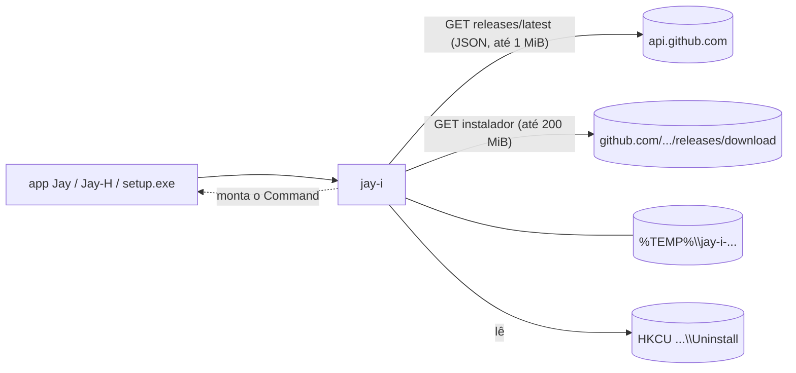

# Jay-I — Arquitetura

**Português** · [English](ARQUITETURA.en.md)

## 1. Objetivo

Hoje três apps da linha Jay levam cópias da mesma lógica: o `products.rs` do Jay-H (instala e atualiza os outros Jays, lê o registro, abre apps), o `update.rs` do Jay-E e o `update.rs` do Jay-C (autoatualização). As cópias já divergiram (seção 4): cada uma ganhou uma proteção que as outras não têm. O Jay-I é a versão única: uma crate Rust sem Tauri que acha a última release no GitHub, escolhe o instalador, baixa, confere e monta o comando que o roda. Só Windows. Licença: MIT.

## 2. Desenho

1. **A crate `jay-i` (etapa 1).** Biblioteca pura. Nada de interface, nada de estado global: as funções recebem o que precisam (repositório, User-Agent) e devolvem `Result<_, String>`. Quem chama decide a interface, o bloqueio de "uma instalação por vez" e quando sair do processo.
2. **O `setup.exe` (etapa 2).** Um programa com a interface Jay que embrulha o instalador NSIS do Tauri de cada app e o roda em silêncio. Se o WebView2 não existir, cai para a janela do NSIS (que sabe instalá-lo). Usa a crate; não tem lógica de instalação própria.
3. **Adoção (etapa 3).** Cada Jay troca a sua cópia pela crate, na ordem Jay-H, Jay-E, Jay-C, depois os outros. A troca de cada app é um commit que apaga código.



## 3. API e conferências

```rust
pub const MAX_INSTALLER: u64 = 200 * 1024 * 1024;   // 200 MiB
pub const MAX_JSON: u64 = 1024 * 1024;              // 1 MiB
pub struct Release { pub tag_name, pub html_url, pub assets: Vec<ReleaseAsset> }  // JSON do GitHub
pub struct ReleaseAsset { name, size, browser_download_url, digest: Option<String> }
pub struct Installer { pub name, pub url, pub size: u64, pub sha256: String }      // depois de todas as conferências
pub fn latest(repo: &str, user_agent: &str) -> Result<Option<Release>, String>;    // 404 = None
pub fn pick_installer(repo: &str, release: &Release) -> Result<Installer, String>;  // pura
pub fn download(installer: &Installer, user_agent: &str, on_progress: impl FnMut(u64, u64)) -> Result<PathBuf, String>;
pub enum Mode { Interactive, Update { relaunch: bool } }
pub fn run(installer: &Path, mode: Mode) -> std::process::Command;  // não roda; quem chama dá spawn e sai, ou espera
pub struct Installed { pub version: String, pub location: String }
pub fn installed(name: &str) -> Result<Option<Installed>, String>;  // HKCU Uninstall\{name}
pub fn newer(latest: &str, current: &str) -> bool;
```

- **`latest`.** `repo` precisa ser `dono/nome` (ASCII alfanumérico, `-`, `_`, `.`; sem `..`); senão erro, antes de qualquer rede. `GET https://api.github.com/repos/{repo}/releases/latest` com o `ureq` 3, só https (redirecionamento para http é recusado), tempos limite de 10 s para resolver e conectar e de 30 s para enviar, receber a resposta e cada leitura, User-Agent do chamador, corpo limitado a 1 MiB. 404 vira `None`.
- **`pick_installer`.** Pega o primeiro arquivo que termina em `_x64-setup.exe`. A URL precisa começar com `https://github.com/{repo}/releases/download/`; o nome não pode ter `/`, `\` nem `:`; o tamanho vai até 200 MiB; o `digest` do GitHub precisa ser `sha256:` mais 64 hexadecimais (maiúsculas passam). Sem `digest`, não há instalador.
- **`download`.** Cria `%TEMP%\jay-i-<pid>-<nanos>-<contador>` com `create_dir` (falha se já existir), lê o corpo com limite de tamanho+1, grava no arquivo enquanto calcula o SHA-256, compara o comprimento e o hash, e apaga a pasta inteira em qualquer falha. Não retoma (os instaladores têm de 2 a 5 MB). Em caso de sucesso a pasta fica, para o chamador rodar dali.
- **`run`.** `Interactive`: sem argumentos (janela do NSIS). `Update { relaunch }`: `/P /UPDATE`, mais `/R` se `relaunch`; `/P` mostra só a barra de progresso, `/UPDATE` mantém as configurações, `/R` reabre o app. Argumentos em lista, nunca por shell.
- **`installed`.** Só por usuário: `HKCU\Software\Microsoft\Windows\CurrentVersion\Uninstall\{name}`, lê `DisplayVersion` e `InstallLocation` sem as aspas. `name` precisa ser ASCII alfanumérico ou `-`. Chave ausente é `None`; `DisplayVersion` ausente é erro.
- **`newer`.** Tira `v`/`V`, ignora `-sufixo` e `+build`, parte faltando vale 0, qualquer parte não numérica significa "não é mais nova".

Dependências: `ureq` 3 (json), `sha2` 0.10, `serde` 1 e `winreg` 0.56 (só Windows). São as que o Jay-H já usa; nenhuma nova. O `serde_json` vem pelo recurso `json` do `ureq` (a crate não o chama direto).

## 4. O que as três cópias faziam de diferente

| # | Ponto | Jay-H | Jay-E | Jay-C | O que o Jay-I mantém |
|---|---|---|---|---|---|
| 1 | Cliente HTTP | `ureq` | `ureq` | WinHTTP (sem pilha TLS em Rust) | `ureq` (rustls). O Jay-C perde o "sem pilha TLS" ao adotar a crate: é o preço |
| 2 | Limite da resposta JSON | não | não | 1 MiB | 1 MiB |
| 3 | Só https, redirecionamentos incluídos | parcial | parcial | sim (flag do WinHTTP; `split_url` recusa http, `user@host`, `:porta`) | `https_only` do `ureq`; a URL do download é fixada em `https://github.com/{repo}/releases/download/` pelo `pick_installer`, o que já exclui usuário e porta |
| 4 | Tempos limite | não | não | 10/10/30/30 s | 10/10/30/30 s, mais um por leitura |
| 5 | 404 em `latest` | erro | "sem release" | "sem release" | `None` |
| 6 | Download | em disco, limite tamanho+1 | em disco, limite tamanho+1 | tudo na memória, depois grava | em disco, em fluxo |
| 7 | Pasta temporária | criada antes, apagada na falha | criada antes, apagada na falha | criada só depois da conferência | como Jay-H/E, com um contador no nome (dois downloads no mesmo instante não colidem) |
| 8 | Comparar versões | `compareVersions` do JS (sufixo ignorado; "1a" lido como 1) | crate `semver` (tag ilegível = não é mais nova; pré-release ordenada) | igual ao Jay-H | a regra do JS, mais estrita: parte não numérica = não é mais nova. Sem `semver` |
| 9 | Validar nome do registro e repositório | só num teste do catálogo | idem | idem | dentro da função: erro antes de tocar o registro ou a rede |
| 10 | Trava de uma instalação por vez | `AtomicBool` | `Mutex` | `AtomicBool` | do chamador (nível do app). A crate pode ser chamada duas vezes (pastas separadas), mas não impede dois instaladores ao mesmo tempo |
| 11 | User-Agent | fixo no app | fixo no app | fixo no app | parâmetro |

## 5. Segurança

Os 10 pontos do checklist da linha, sobre a etapa 1. Para cada um: o que foi conferido e o que não foi.

1. **Superfície de ataque.** Dois GET https de saída (`api.github.com`, `github.com`), uma leitura do registro, um processo lançado (por quem chama). Sem listener, sem IPC próprio. *Conferido:* é só isso no código. *Não conferido:* o que o instalador NSIS faz depois de lançado; está fora da crate.
2. **Controle de acesso / IDOR.** O chamador passa `repo` e `name`; a crate os valida (seção 3). Mas um chamador que deixe uma página escolher o `repo` ainda poderia apontar para qualquer repositório do GitHub que case com a regra. *Conferido:* a validação e a URL fixada. *Não conferido:* os chamadores; eles precisam ter um catálogo fixo de repositórios e nunca repassar texto da página.
3. **Permissões de dados.** Arquivos em `%TEMP%` com as permissões padrão do usuário; registro por usuário (HKCU). Nenhum dado do estudante é tocado. *Não conferido:* ACLs próprias na pasta temporária (não há).
4. **Entrada não confiável até operação sensível.** O JSON da release passa por validação de URL, nome do arquivo, tamanho e hash antes de virar `Installer`. O caminho do instalador só vem da nossa pasta temporária. Os argumentos são uma lista fixa, sem shell. O nome no registro é validado. *Conferido:* testes do ponto 10. *Não conferido:* o conteúdo do instalador.
5. **Credenciais expostas.** Nenhuma. Sem token; a API do GitHub é anônima, com limite de 60 requisições por hora por IP. *Conferido:* nada de segredo no código nem nos testes. *Efeito:* atrás de um IP compartilhado, `latest` pode falhar com 403; o chamador mostra o erro.
6. **Autenticação.** TLS para `api.github.com` e `github.com` (rustls, raízes do webpki). Os instaladores **não são assinados** (code signing). O SHA-256 vem do `digest` do próprio GitHub, ou seja, da mesma raiz de confiança do download: protege contra corrupção, truncamento e um objeto trocado na CDN, **não** contra uma conta ou um repositório do GitHub comprometido. *Não conferido:* a identidade de quem publicou a release.
7. **Abuso de recursos e corridas.** JSON limitado a 1 MiB, instalador a 200 MiB, corpo lido até tamanho+1, tempos limite em toda etapa. TOCTOU entre a conferência e a execução: o arquivo fica numa pasta nova por chamada em `%TEMP%`, e outro processo do mesmo usuário poderia trocá-lo antes de o chamador rodar; mas um atacante com o mesmo usuário já ganhou. A crate não tem trava de instalação (seção 4, linha 10).
8. **Cadeia de dependências.** `ureq`, `rustls`, `sha2`, `serde`, `winreg`. `Cargo.lock` no git. `cargo audit`: não rodado. *Conferido:* nenhuma dependência nova em relação ao Jay-H.
9. **Rede e exposição.** Só saída, `https_only`, nenhum socket em escuta.
10. **Testes adversariais e critérios de release.** Casos, todos sem rede, exceto o último:
    - URL com host parecido (`github.com.evil.example`) recusada;
    - URL com usuário (`github.com@evil`) recusada;
    - URL de outro repositório recusada;
    - URL `http:` recusada;
    - truque de prefixo (`Jay-C-evil` para o repositório `Jay-C`) recusado;
    - `digest` ausente, curto, longo, não hexadecimal ou `md5:` recusado; maiúsculas aceitas;
    - tamanho acima do limite recusado;
    - nome do arquivo com `\` ou `:` recusado;
    - `repo` e `name` com `/..` ou barra invertida recusados;
    - corpo maior que o declarado recusado;
    - tamanho certo e hash errado: nem o arquivo nem a pasta sobrevivem;
    - corpo menor que o declarado recusado;
    - um teste `#[ignore]` baixa um instalador real do Jay-C e o confere (nunca roda).

    Resultado (10/11/2026, Windows 11, Rust 1.99.1): `cargo test` → `11 passed; 0 failed; 1 ignored`; `cargo clippy --all-targets -- -D warnings` sem avisos; `cargo test -- --ignored` → `1 passed`: baixou o `Jay-C_0.5.2_x64-setup.exe` (v0.5.2, 2 436 827 bytes) e o SHA-256 `33b00918…68c21a3` bateu com o `digest` do GitHub. A URL `http:` é recusada pelo `https_only` antes de qualquer conexão (o teste confere a mensagem). *Não conferido:* um redirecionamento https→http de verdade e um servidor que mande corpo maior ou errado (sem servidor de teste: esses casos são provados no `store`, a parte do download que recebe o corpo).

    **Bloqueia a release:** qualquer um desses falhando, ou `cargo clippy` com avisos.

## 6. Etapas

| Etapa | O quê | Estado |
|---|---|---|
| 1 | A crate `jay-i` | ✅ |
| 2 | `setup.exe` com a interface Jay, em volta do instalador NSIS de cada app, rodando em silêncio e caindo para a janela do NSIS sem WebView2 | a fazer |
| 3 | Cada Jay (Jay-H, Jay-E, Jay-C, depois os outros) troca a própria cópia pela crate | a fazer |
